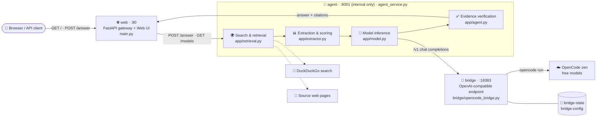

# 🔎 SourceCheck AI

**Autonomous Web Information Retrieval Agent** — grounded answers, exact citations.  
*Built for the AMD AI League — Match 4: Intelligent Web Information Retrieval* 🏆

[](https://hub.docker.com/r/mbu7865669/sourcecheck-web)
[](https://hub.docker.com/r/mbu7865669/sourcecheck-agent)
[](https://hub.docker.com/r/mbu7865669/sourcecheck-bridge)
[](https://www.python.org/)

---

## 🔗 Quick links

| What | URL |
| --- | --- |
| 💻 **Source code (GitHub)** | https://github.com/mbu7865669-max/SourceCheck-Ai |
| 🌐 **Docker Hub — web gateway + Web UI** | https://hub.docker.com/r/mbu7865669/sourcecheck-web |
| 🧠 **Docker Hub — agent pipeline** | https://hub.docker.com/r/mbu7865669/sourcecheck-agent |
| 🌉 **Docker Hub — OpenCode bridge** | https://hub.docker.com/r/mbu7865669/sourcecheck-bridge |
| 📋 **Prerequisites / install** | [§4 Prerequisites](#4--prerequisites) |
| 🖥️ **Web UI** *(once the stack is up)* | http://localhost/ |
| ❤️ **API health check** | http://localhost/health |
| 📖 **Swagger UI / ReDoc** | http://localhost/docs · http://localhost/redoc |
| 🌉 **OpenCode bridge** | http://localhost:18383/health |

```bash
docker pull mbu7865669/sourcecheck-web:1.2.0      # 🌐 gateway + Web UI
docker pull mbu7865669/sourcecheck-agent:1.2.0    # 🧠 retrieval → verification → reasoning
docker pull mbu7865669/sourcecheck-bridge:1.1.0   # 🌉 OpenCode bridge (free models)
```

Full endpoint list: [§6 Endpoints & URLs](#-endpoints--urls).

---

## 1. 🎯 Project Overview

**SourceCheck AI** is an autonomous web information retrieval and question-answering agent. Given a natural-language question, it queries the live web, extracts and verifies primary source evidence, and returns a concise, grounded factual answer alongside the exact supporting citation. If reliable evidence cannot be found or verified, it explicitly abstains rather than generating an unsupported answer.

### Key Goals
- 🎯 **Factual Precision:** Target exact answers (names, dates, numbers, specifications, versions) rather than generic, open-ended conversational summaries.
- 🚫 **Zero Hallucination & Explicit Abstention:** Strictly verify that the answer is supported by the retrieved source excerpt. If unverified, return `status: "insufficient_evidence"`.
- ⚡ **Low Latency:** Optimize retrieval and inference to complete under strict evaluation ceilings (sub-30-second target).
- 🔓 **Open-Source & AMD ROCm Ready:** Powered by open-source models suitable for execution on AMD GPU hardware using the AMD ROCm environment, without dependencies on paid proprietary APIs.

---

## 2. 🔄 Core Workflow Pipeline

1. 🧩 **Question Analysis:** Parse the user question and determine the expected answer type (e.g., date, number, person, specification).
2. 🌍 **Search & Retrieval:** Generate targeted search queries and fetch candidate web pages with bounded retries and timeouts.
3. 🧹 **HTML Cleaning & Extraction:** Strip boilerplate and extract clean text and structured data tables.
4. 📊 **Passage Scoring:** Rank and select top relevant evidence passages to minimize prompt token length.
5. 🤖 **Model Inference:** Utilize an open-source language model to extract the factual candidate answer and exact supporting excerpt.
6. ✅ **Evidence Verification:** Confirm that the answer verbatim exists in the retrieved context; abstain if unsupported.
7. 📦 **Structured Output:** Return standardized, machine-readable JSON containing `answer`, `sources`, `claims` (each with its verbatim evidence quote), `status`, `errors`, and `notices` — the last two split genuine failures from expected skips such as a source that refused the request.

> 💡 **Sites that refuse us** (HTTP 401/403/429/451) are skipped and reported as a
> neutral **notice** — e.g. *"Skipped https://… - refused by the site (HTTP 403)"* —
> not as an error. The agent identifies itself honestly and respects the refusal;
> the answer is built from the sources that did respond.

---

### 🏗️ Architecture



Startup is gated by healthchecks: **bridge healthy → agent → web**. Only `web` (80) and `bridge` (18383) publish host ports. The Web UI is served on port **80** at both `/` and `/ui`, so port 80 must be free on the host and open in the firewall / cloud security group.

---

## 3. 🗂️ Project Structure

```text
SourceCheck-Ai/
├── app/
│   ├── __init__.py           # Application package marker
│   ├── config.py             # Configuration and environment variable management
│   ├── schemas.py            # Pydantic data models for requests, responses, and evidence
│   ├── retrieval.py          # Search provider integration and HTTP fetching/parsing
│   ├── extractor.py          # Relevant passage ranking and text extraction
│   ├── model.py              # Model interface: mock / local ROCm / local server / OpenCode bridge
│   ├── agent.py              # Full pipeline orchestration coordinator
│   ├── health.py             # Shared bridge health-probe helpers
│   └── static/
│       └── index.html        # Self-contained browser UI (served at GET / and /ui)
├── bridge/
│   ├── opencode_bridge.py    # OpenAI-compatible bridge backed by the OpenCode CLI (stdlib only)
│   ├── Dockerfile            # Bridge image: pinned OpenCode CLI + bridge script
│   ├── run-bridge.ps1        # Windows launcher: start / test / models / stop / status
│   └── README.md             # Bridge setup, configuration, troubleshooting
├── tests/
│   ├── test_agent.py         # Agent orchestration and grounded-reasoning tests
│   ├── test_agent_service.py # Agent HTTP service tests
│   ├── test_extractor.py     # Passage splitting and relevance ranking tests
│   ├── test_health.py        # Bridge health-probe tests
│   ├── test_retrieval.py     # Search, fetching, HTML cleaning, SSRF guard tests
│   ├── test_model.py         # Model factory + OpenCode bridge contract tests
│   └── test_main.py          # Gateway routes, Web UI serving and CLI tests
├── main.py                   # 🌐 Web gateway entrypoint (FastAPI server & CLI interface)
├── agent_service.py          # 🧠 Agent service entrypoint (the pipeline, on :8001)
├── requirements.txt          # Python dependencies
├── Dockerfile                # Web gateway image
├── Dockerfile.agent          # Agent image (same source tree, different entrypoint)
├── docker-compose.yml        # 🐳 web :80 → agent :8001 → bridge :18383
├── .dockerignore             # Keeps caches, VCS and secrets out of the build context
├── .gitignore                # Git exclusions (caches, venvs, secrets)
└── README.md                 # Project documentation and guide
```

---

## 4. 📋 Prerequisites

Two ways to run it — take **A** if you just want it working, **B** if you're hacking on the source.

### A. 🐳 Docker (recommended — nothing else on the host)

| Requirement | Why | Check |
| --- | --- | --- |
| Docker Engine 24+ | builds and runs all three images | `docker version` |
| Docker Compose v2 (`docker compose`) | starts the three-service stack | `docker compose version` |
| Internet access | image pulls, DuckDuckGo retrieval, free-model bridge | — |
| git | clone the repo (optional — you can run the images alone) | `git --version` |

Install Docker with **Docker's official convenience script** (Linux):

```bash
# Docker's own install script: adds the official repo and installs
# docker-ce, the compose plugin, buildx and containerd.
curl -fsSL https://get.docker.com | sudo sh

# allow docker without sudo from now on
sudo usermod -aG docker "$USER"
newgrp docker                      # apply it in this shell, or log out/in

# confirm both the engine and the compose plugin
docker version
docker compose version
```

> 🍎🪟 **macOS / Windows:** install [Docker Desktop](https://docs.docker.com/get-docker/)
> instead (it ships the same engine + `docker compose`), or use WSL2 on Windows and
> run the script above inside it. Rootless installs work too — see
> [Docker's install docs](https://docs.docker.com/engine/install/).

**The Docker path needs neither Python nor the OpenCode CLI on your host:** the
`bridge` image bakes in the pinned OpenCode CLI (`OPENCODE_VERSION`, default
`2.1.4`), and the `web` / `agent` images bake in Python 3.11 plus every dependency
in `requirements.txt`.

### B. 🐍 Running from source (no Docker)

| Requirement | Version | Why |
| --- | --- | --- |
| Python | 3.10+ (3.11 recommended) | app, CLI and test suite |
| pip / venv | any | installs `requirements.txt` |
| OpenCode CLI | **v2.1.4** (the version the bridge's compat patch targets) | free-model backend |
| git | any | clone |

```bash
# 1. Python dependencies
python3 -m venv .venv && source .venv/bin/activate
pip install -r requirements.txt

# 2. OpenCode CLI — use the OpenCode 2 installer (the v1 one refuses 2.x)
curl -fsSL https://opencode.ai/v2/install | bash -s -- --version 2.1.4
export PATH="$HOME/.opencode/bin:$PATH"
opencode --version                 # expect: opencode v2.1.4

# 3. start the bridge, then ask a question — see §5 below
```

The bridge inherits your existing OpenCode login and needs no API key of its own. 🔑

### ✔️ Verify your setup

```bash
docker version && docker compose version   # Docker path
python3 --version                          # source path
opencode --version                         # source path (bridge backend)
```

Then jump to **[§6 Running with Docker](#6--running-with-docker)** or
**[§5 Running with OpenCode's Free Models](#5--running-with-opencodes-free-models)**.

---

## 5. 🆓 Running with OpenCode's Free Models

The agent can reason with OpenCode's **free** models by routing requests through a local
bridge that exposes an OpenAI-compatible endpoint:

```
SourceCheck agent ──HTTP──▶ bridge :18383 ──▶ `opencode run` ──▶ opencode zen (free, $0)
```

```powershell
# 1. start the bridge (keeps running in its own window)
.\bridge\run-bridge.ps1 background

# 2. confirm it is healthy and list the free models
.\bridge\run-bridge.ps1 test
.\bridge\run-bridge.ps1 models

# 3. ask a question through the agent
$env:MODEL_PROVIDER = "opencode"
python main.py "What year did the first human walk on the Moon?"

# ...or serve the agent over HTTP
python agent_service.py
curl -X POST http://127.0.0.1:8001/answer -H "content-type: application/json" `
     -d '{"question":"What year did the first human walk on the Moon?"}'
```

Set `MODEL_PROVIDER=opencode` in `.env` to make it the default. Other providers remain
available: `mock` (offline, the test-suite default), `local_rocm`, `local_server`.
Full bridge documentation: [`bridge/README.md`](bridge/README.md).

Prefer containers? Section 6 runs the same wiring with nothing to install locally. 🐳

---

## 6. 🐳 Running with Docker

The repo ships **three images**, wired together by `docker-compose.yml`. Each hop
only talks to the next one:

```
browser ──▶ 🌐 web :80 ──HTTP──▶ 🧠 agent :8001 ──HTTP──▶ 🌉 bridge :18383 ──▶ `opencode run` ──▶ opencode zen (free, $0)
            gateway + Web UI       retrieve → verify →       OpenAI-compatible
                                   reason (internal only)    endpoint
```

| Service | Image | Host port | Purpose |
| --- | --- | --- | --- |
| 🌐 `web` | `mbu7865669/sourcecheck-web` | **80** → 8000 | Gateway: **Web UI at `/`**, validates input, proxies `POST /answer` to the agent |
| 🧠 `agent` | `mbu7865669/sourcecheck-agent` | *none* (internal :8001) | The retrieval → verification → reasoning pipeline |
| 🌉 `bridge` | `mbu7865669/sourcecheck-bridge` | 18383 | OpenAI-compatible endpoint backed by the OpenCode CLI |

The agent runs with `MODEL_PROVIDER=opencode` and
`BRIDGE_ENDPOINT=http://bridge:18383/v1`; the web gateway uses
`AGENT_ENDPOINT=http://agent:8001`. Everything travels over the compose network —
no host setup, no PowerShell, no `.env` edits. Startup order is enforced by
healthchecks: **bridge healthy → agent starts → agent healthy → web starts**.

### ▶️ Start the stack

```bash
docker compose up -d --build     # build the images and start all three services
docker compose ps                # all three must report "healthy"
docker compose logs -f web agent # uvicorn output
open http://localhost/      # the Web UI (xdg-open on Linux)
```

### 🖥️ Web UI

Open **http://localhost/** in a browser — `/` serves the page to browsers
(`Accept: text/html`) and keeps returning the JSON service metadata to API clients
(`curl`, `application/json`), so nothing that already talked to the API breaks.
`http://localhost/ui` serves the same page unconditionally. It's a
self-contained page (no build step, no CDN), so every question it sends takes the
exact same web → agent → bridge path as the API:

- 🤖 **free-model picker** next to *Ask agent* — choose any of the bridge's free
  models (`mimo-v2.6-flash-free`, `deepseek-v4.1-flash-free`, `glm-5.3-flash-free`,
  `nemotron-3.5-*`, …). The list is fetched live through web → agent → bridge, so it
  only ever offers models the bridge accepts; your pick is remembered, and each answer
  card shows which model produced it;
- ⌨️ ask a question with the composer (**Enter** sends, **Shift+Enter** adds a line,
  **/** focuses the box from anywhere), or click an example chip;
- 🟢 live status pill: model provider, search provider, bridge reachability,
  OpenCode version and model — and it names the broken hop (**agent unreachable**
  vs **bridge unreachable**) when something is down;
- 🃏 per-question card with verified/abstain/error badge, elapsed time, the grounded
  answer (+ copy), sources, claim-level citations with verbatim evidence quotes,
  neutral **Notes** for sources that refused the request (403/429/…), and a red
  **Diagnostics** box only for genuine failures;
- 💾 **answer history** — the last 20 answers survive a page reload (stored only in
  your browser) with a **Clear history** button;
- ⚙️ collapsible **Retrieval settings** to override search results, pages fetched and
  evidence passages per request — remembered between visits;
- ⏹️ a **Stop** button that aborts a slow run (the request ceiling is 5 minutes, well
  beyond a typical free-tier model turn);
- 🌗 light / dark theme toggle (follows your OS by default).

### ⚡ Optimizations

| Area | What | Effect |
| --- | --- | --- |
| 📦 Transfer | gzip on the gateway | Web UI **51 KB → 13 KB** on the wire |
| 🔁 Caching | `Cache-Control: no-cache` + ETag → `304 Not Modified` | reloads skip the body, yet a redeploy is never stale |
| 🎨 Rendering | aurora background on its own fixed, composited layer | no full-page repaint on scroll (smooth on mobile) |
| 🃏 Rendering | `content-visibility: auto` on answer cards | long histories don't slow layout |
| 💤 Polling | `/health` polling pauses in background tabs, never overlaps | no gateway → agent → bridge probes for tabs nobody sees |
| ❤️ Healthchecks | Docker probes cheap `/livez` instead of `/health` | container healthchecks no longer fan out to the agent and bridge |
| 🧟 Processes | `init: true` on every service | signals forwarded, the bridge's `opencode` subprocesses reaped |
| 📜 Logs | json-file rotation, `10m × 3` per service | container logs can't fill the disk |
| 🔒 Security | web and agent run as the unprivileged `app` user | no root inside the Python containers |
| 🏷️ Favicon | inline SVG icon | no more `GET /favicon.ico 404` on every page load |

### 🧭 Endpoints & URLs

Everything reachable while the stack is up — host ports, and the in-network
hostnames the containers use to talk to each other:

| URL | On | Method | Purpose |
| --- | --- | --- | --- |
| `http://localhost/` | host | GET | 🖥️ **Web UI** in a browser · JSON service metadata for API clients |
| `http://localhost/ui` | host | GET | Web UI, unconditionally (same page) |
| `http://localhost/health` | host | GET | ❤️ Gateway + agent + model provider + bridge reachability |
| `http://localhost/models` | host | GET | 🤖 Free models available for the picker (via the agent, from the bridge) |
| `http://localhost/livez` | host | GET | Gateway process liveness only (used by the Docker healthcheck) |
| `http://localhost/answer` | host | **POST** | 🔎 Full pipeline: retrieve → verify → reason → cited answer |
| `http://localhost/docs` | host | GET | 📖 Swagger UI (interactive API explorer) |
| `http://localhost/redoc` | host | GET | ReDoc reference docs |
| `http://localhost/openapi.json` | host | GET | OpenAPI schema (`/ui` and `/livez` are excluded) |
| `http://localhost:18383/health` | host | GET | 🌉 Bridge liveness + OpenCode version + in-flight count |
| `http://localhost:18383/v1/chat/completions` | host | POST | OpenAI-compatible completions (blocking + SSE) |
| `http://localhost:18383/v1/models` | host | GET | Free-model catalogue |
| `http://localhost:18383/metrics` | host | GET | 📈 Requests, errors, cost, uptime |
| `http://localhost:18383/config` | host | GET | Effective bridge configuration |
| `http://agent:8001/answer` | compose network | POST | 🧠 The agent pipeline — `AGENT_ENDPOINT` the gateway proxies to |
| `http://agent:8001/health` | compose network | GET | Agent + bridge reachability |
| `http://agent:8001/models` | compose network | GET | Bridge's free-model catalogue, passed through |
| `http://bridge:18383/v1` | compose network | — | `BRIDGE_ENDPOINT` the agent is configured with |

### ✅ Verify

```bash
# liveness + full chain (agent.reachable and bridge.reachable must be true)
curl http://localhost/health

# the UI (open it in a browser) — / serves it to browsers, /ui always
curl -I -H "Accept: text/html" http://localhost/
curl -sI -H "Accept-Encoding: gzip" http://localhost/ui | grep -i content-encoding
# API clients still get JSON metadata from /
curl -H "Accept: application/json" http://localhost/

# full pipeline: web -> agent -> bridge -> free model -> grounded, cited answer
curl -X POST http://localhost/answer -H "content-type: application/json" \
     -d '{"question":"What year did the first human walk on the Moon?"}'

# 🤖 list the free models, then answer with a specific one
curl http://localhost/models
curl -X POST http://localhost/answer -H "content-type: application/json" \
     -d '{"question":"What year did the first human walk on the Moon?","model":"opencode/deepseek-v4.1-flash-free"}'
# a model outside the free catalogue is refused up front with HTTP 400 — no retrieval is spent

# 🔍 trace it: one POST per hop, and no errors anywhere
docker compose logs web agent bridge | grep -E "POST|error"
```

### 🧪 Run the test suite against the image

```bash
docker compose run --rm --no-deps web pytest -q
```

The image contains `tests/`, so this exercises the exact bytes that ship — not
your local virtualenv.

### 🛠️ Other commands

```bash
docker compose down                # stop and remove the containers
docker compose up -d --build       # rebuild after pulling new code
docker compose run --rm --no-deps agent python main.py "your question"   # one-off CLI query
```

### 📦 Published images on Docker Hub

All three images are **public**, so the stack can be started from the registry alone:

| Image | Tags | Digest (sha256) | Hub page |
| --- | --- | --- | --- |
| `mbu7865669/sourcecheck-web` | `1.2.0`, `latest` | `47439642be6dcd2985515492477504d22e9e644eb596d0a02ffd55ea43e21ec3` | [hub.docker.com/r/mbu7865669/sourcecheck-web](https://hub.docker.com/r/mbu7865669/sourcecheck-web) |
| `mbu7865669/sourcecheck-agent` | `1.2.0`, `latest` | `e747c18decf3bd4c3c4f7a7cc404dc2698184819dd531953cbede680f2fa2d9a` | [hub.docker.com/r/mbu7865669/sourcecheck-agent](https://hub.docker.com/r/mbu7865669/sourcecheck-agent) |
| `mbu7865669/sourcecheck-bridge` | `1.1.0`, `latest` | `950c158aeea3f94cda3eda50819b154534ee44195e80dda7eb491be90931a816` | [hub.docker.com/r/mbu7865669/sourcecheck-bridge](https://hub.docker.com/r/mbu7865669/sourcecheck-bridge) |

```bash
docker pull mbu7865669/sourcecheck-web:1.2.0
docker pull mbu7865669/sourcecheck-agent:1.2.0
docker pull mbu7865669/sourcecheck-bridge:1.1.0

# 📌 pin a specific build instead of trusting the tag
docker pull mbu7865669/sourcecheck-web@sha256:47439642be6dcd2985515492477504d22e9e644eb596d0a02ffd55ea43e21ec3
```

### 🚀 Start from the published images (no local build)

```bash
git clone https://github.com/mbu7865669-max/SourceCheck-Ai.git
cd SourceCheck-Ai
docker compose pull            # fetch the published images
docker compose up -d --no-build
open http://localhost/
```

### 📝 Notes

- 🌐 The `bridge` container needs **outbound internet** (it drives the OpenCode CLI)
  but **no API keys** — the free zen tier is keyless.
- ⏳ Free tiers rate-limit. When the quota runs out the agent logs
  `Model generation error: ... Free usage limit reached` and the answer card shows a
  **Diagnostics** box; it recovers on its own once the quota resets.
- 💾 OpenCode session state and config live in the `bridge-state` and `bridge-config`
  named volumes (`/home/bridge/.local/share/opencode` and
  `/home/bridge/.config/opencode`), so they survive restarts *and* container
  recreation. The CLI itself is baked into the image and is deliberately **not**
  volume-mounted — rebuilding with a different `OPENCODE_VERSION` therefore takes
  effect immediately, instead of being shadowed by a stale volume copy.
- 🔒 Only expose what you need: bind the published ports to loopback
  (`127.0.0.1:80:8000` / `127.0.0.1:18383:18383`) if the host is internet-facing —
  neither service has authentication of its own. The agent publishes no port at all.
- ℹ️ `WARNING: Invalid HTTP request received.` in the web logs means a browser tried
  `https://` against the plain-HTTP port — harmless; use `http://`.
- 🔨 Rebuild with `docker compose build --no-cache` if a base image or the pinned
  OpenCode CLI version (`OPENCODE_VERSION` build arg) changes.

---

## 7. 🗺️ Planned Milestones

- [x] ✅ **Milestone 1 — Requirements and Architecture:** Skeleton setup, architecture design, and requirement breakdown.
- [x] ✅ **Milestone 2 — Basic Retrieval:** Search query execution, HTTP fetching, HTML cleaning, and test cases.
- [x] ✅ **Milestone 3 — Model Integration:** Model abstraction (`app/model.py`) with mock, CPU/ROCm, local-server and OpenCode-bridge backends.
- [x] ✅ **Milestone 4 — Evidence Verification:** Exact answer extraction, source citation matching, and abstention handling.
- [ ] ⏳ **Milestone 5 — Evaluation and Optimization:** Benchmark testing against question sets for latency, accuracy, and refusal correctness.
- [x] ✅ **Milestone 6 — Docker and Submission:** Three-container stack (web → agent → bridge), deployment documentation, and submission deliverables.
